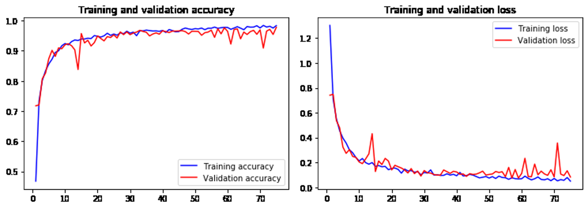
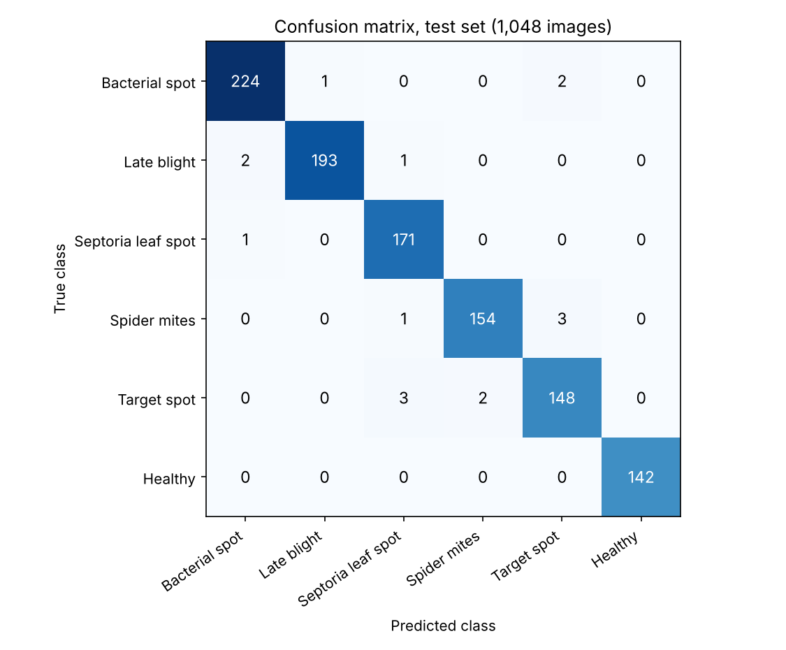
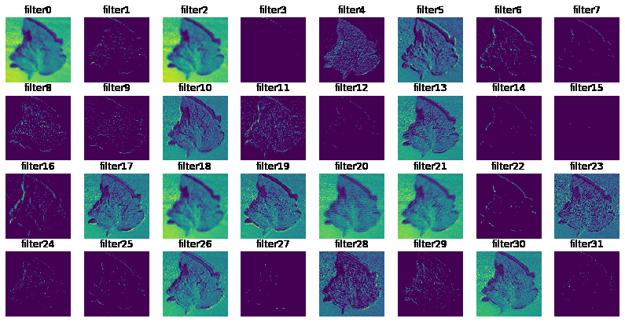

# Tomato Leaf Disease Classification with a CNN

Bachelor's thesis project in Computer Science and Engineering at Mekelle University (Mekelle Institute of Technology), 2020. It was a group project of two students. A convolutional neural network classifies a photo of a tomato leaf as healthy or as one of five diseases.

**Result:** **98.47% accuracy** on a held-out test set of 1,048 leaf images (1,032 correct).

## Data

- Public **PlantVillage** dataset, tomato subset: **10,477 images, 6 classes** (five diseases and healthy leaves). The images are not included in this repo. Download the tomato folders and set `directory_root` in the notebook to their location.
- Classes: Bacterial spot, Late blight, Septoria leaf spot, Spider mites (two-spotted spider mite), Target spot, Healthy.
- Images are resized to 150 x 150 pixels and scaled to the 0 to 1 range.
- Split: 10% test, then 80% training and 20% validation of the rest (stratified). Training images are augmented on the fly (rotation, shifts, shear, zoom, horizontal flip).

## Model

A small CNN built with Keras, 3,373,926 trainable parameters:

- Three convolution blocks (32, 32, 64 filters, ReLU) each followed by max pooling
- Flatten, then dense layers of 512 (with 25% dropout) and 128 units
- Softmax output over the 6 classes
- Adam optimizer (learning rate 0.001), categorical cross-entropy, batch size 32, 75 epochs

## Results

Test set, 1,048 images:

| Class | Precision | Recall | F1 | Images |
|---|---|---|---|---|
| Bacterial spot | 0.987 | 0.987 | 0.987 | 227 |
| Late blight | 0.995 | 0.985 | 0.990 | 196 |
| Septoria leaf spot | 0.972 | 0.994 | 0.983 | 172 |
| Spider mites | 0.987 | 0.975 | 0.981 | 158 |
| Target spot | 0.967 | 0.967 | 0.967 | 153 |
| Healthy | 1.000 | 1.000 | 1.000 | 142 |

Only 16 of the 1,048 test images were misclassified. Target spot is the hardest class: it is mixed up with Spider mites in 5 images (3 and 2 in the two directions) and predicted as Septoria leaf spot in 3 images.

The notebook also visualises what the network learns, by plotting the feature maps after each convolution and pooling layer for one image. First convolution layer:

## Run it

1. Install the packages in `requirements.txt` (the code uses the old Keras and TensorFlow 1.x API, for example `fit_generator`).
2. Download the PlantVillage tomato images and set `directory_root` in the notebook.
3. Run `Tomato_Leaf_Disease_CNN.ipynb` from top to bottom. The saved outputs of my original run are already in the notebook.

## Limitations

- PlantVillage photos are taken in controlled conditions (one leaf, plain background). Accuracy on photos taken in a real field would likely be lower.
- The test set has only 1,048 images, so each misclassified image moves the accuracy by about 0.1 percentage points.
- The model covers only tomato leaves and only these six classes.

## Tools

Python, Keras, TensorFlow, OpenCV, scikit-learn, NumPy, Matplotlib, Seaborn, Jupyter.
